# Benchmark: SNOPT vs. Ipopt on the test problems

`benchmark_problems.jl` solves every problem in [`test/problems.jl`](../test/problems.jl)
with `solve_snopt` and `solve_ipopt` and compares objective value, accuracy, CPU
time, `fitness` evaluation count, iteration counts, and the path of iterates.

```sh
julia benchmark/benchmark_problems.jl
```

The script activates the `demo/` environment, so it can be run from any directory.
It writes `results.csv` (all recorded quantities), `times.csv` (every timed
solve), `plots/cpu_time_boxplot.png`, `plots/evals_barplot.png`, and, for 2-D
problems only, `plots/<problem>_path.png`.

With the argument `auto`, every solve passes `jac_sparsity = :auto`, so the
sparsity pattern is detected with SparseConnectivityTracer (inside every timed
solve) and the solvers get a sparse Jacobian. The outputs then carry the
suffix `_auto` (`results_auto.csv`, `times_auto.csv`, `plots/cpu_time_boxplot_auto.png`,
`plots/evals_barplot_auto.png`; the path plots are not redrawn):

```sh
julia benchmark/benchmark_problems.jl auto
```

**Archive.** `results_log/` keeps `results.csv` from earlier runs, named
`results_<commit>.csv` (and `results_<commit>_auto.csv` for the `auto` run), so
CPU times can be compared across versions.

**Dense vs. sparse Jacobian.** `sparse_jacobian.jl` benchmarks `jac_sparsity`
on a scalable collocation problem; see the Sparse Jacobian page of the
documentation (`docs/src/sparse_jac.md`) for the protocol and results.

```sh
julia benchmark/sparse_jacobian.jl        # CPU time, fitness calls, allocations -> sparse_results.csv
julia benchmark/sparse_jacobian_rss.jl    # peak RSS, Linux only -> sparse_rss.csv
julia benchmark/plot_sparse.jl            # redraw docs/src/assets/sparse_*.png from both CSVs
```

## Protocol

For each (problem, solver) pair:

1. **Warm-up.** One untimed solve, so JIT compilation is not counted.
2. **Timing.** `M = 10` solves, each preceded by `GC.gc()`. Each solve is timed
   with the process CPU clock (`clock()`), not wall time. The table reports the
   mean and the range (min, max) of the 10 times.
3. **Record run.** One more untimed solve with a `fitness` wrapper that logs every
   point where `fitness` is evaluated, skipping a call at the same point as the
   previous call (Dual-number calls are logged at their primal value). The solver's print file is written in this run only, and
   the iteration counts are read from it. For SNOPT these are the **major
   iterations** (`No. of major iterations`) and the total **minor (QP)
   iterations** (`No. of iterations`). For Ipopt it is the **Ipopt iterations**
   (`Number of Iterations`). `xopt`, `fopt`, and the plotted path come from this
   run. Both solvers are deterministic, so the timed runs return the same result.

All problems start from the `x0` given in `test/problems.jl`.

**Environment.** AMD Ryzen 9 7900X, Linux, Julia 1.12.1, Ipopt.jl 1.16.0
(Ipopt_jll 300.1400.1902), SNOPT 7 (`libsnopt7.so`).

## Solver settings and comparability

**Both solvers receive the same information.** They get the same `fitness`,
bounds, and `x0`, and the same dense Jacobian of `[obj; ceq; cineq]`, computed with
ForwardDiff by the evaluator that `solve_snopt` and `solve_ipopt` share
(`deriv = :forwarddiff`). Neither is told the sparsity pattern or which
constraints are linear, and neither gets second derivatives: each builds its own
quasi-Newton approximation of the Hessian of the Lagrangian.

The benchmark sets the options below (`run_solver` in `benchmark_problems.jl`).
These are benchmark settings only: the package defaults of `solve_snopt` and
`solve_ipopt` are unchanged. Every other option is the solver's default.

| | SNOPT | Ipopt |
|---|---|---|
| Feasibility tolerance | `Major_feasibility_tolerance = 1e-6` | `constr_viol_tol = 1e-6` |
| Optimality tolerance | `Major_optimality_tolerance = 1e-6` | `tol = dual_inf_tol = compl_inf_tol = 1e-6` |
| Hessian approximation | Full-memory BFGS (SNOPT's default for at most 75 nonlinear variables) | L-BFGS with `limited_memory_max_history = min(max(20, n), 75)`, which is 20 for every problem here |
| Output | None | `print_level = 0`, `sb = "yes"` |

What this does and does not make equal:

- **Tolerances.** The thresholds match, but the tests do not. SNOPT measures
  feasibility relative to the size of `x` and optimality relative to the size of
  the multipliers. Ipopt applies `tol` to its scaled overall error and the other
  three as absolute bounds on the unscaled problem. SNOPT's default feasibility
  tolerance is already 10⁻⁶, so for SNOPT only the optimality tolerance changes
  (default 2 × 10⁻⁶). Ipopt's default `tol` is 10⁻⁸.
- **Ipopt defaults that still matter.** `bound_relax_factor = 1e-8` relaxes every
  bound, including the constraint bounds, by about 10⁻⁸ before the solve. Ipopt's
  `xopt` can therefore be about 10⁻⁸ outside a bound or constraint, which is well
  inside the 10⁻⁶ feasibility tolerance (see Findings). Ipopt's acceptable-level
  exit is also left on: after 15 consecutive iterations that meet
  `acceptable_tol = 1e-6` and looser acceptable violation and complementarity
  tolerances (10⁻²), it stops with `Solved_To_Acceptable_Level`. That did not
  happen here: all 34 runs ended with `Solve_Succeeded`.
- **Hessian memory.** Ipopt's default L-BFGS memory is 6 pairs. With 20 pairs it
  is much closer to SNOPT's full-memory BFGS, but not the same method. Ipopt
  recomputes its initial matrix σI from the newest pair at every iteration, skips
  updates that fail the curvature condition (and clears its memory once more than
  `limited_memory_max_skipping = 2` successive updates are skipped), and works at
  its own multipliers. The cap of 75 mirrors the point
  where SNOPT itself switches to limited memory. Larger memory is not free in
  Ipopt (see Findings).
- **Iteration counts measure different work.** A SNOPT major iteration solves a
  QP, which takes zero or more minor iterations. An Ipopt iteration is one Newton
  step on the barrier problem.
- **`fitness` evaluation points.** The tables and the bar plot count *evaluation
  points*: `fitness` calls at a point different from the previous call's point,
  so repeated calls at one point count once. This is close to, but not the same
  as, the number of `fitness` calls, and the two solvers' calls differ in kind:
  - At each accepted iterate, Ipopt calls `fitness` twice: a plain call for the
    value at the trial point, then a Dual (ForwardDiff) call for the Jacobian.
    That counts as one point. Ipopt's line-search trial points need only the
    plain call.
  - SNOPT's default derivative line search asks for the Jacobian at every trial
    point, so almost all its calls are Dual calls, which cost more than plain
    ones. On Rosenbrock 10-D, for example, Ipopt makes 166 plain and 101 Dual
    calls (167 points), and SNOPT makes 2 plain and 77 Dual calls (78 points).
    These call counts were measured separately and are not in `results.csv`.
  - Every SNOPT count includes one point from its cheap derivative check near
    `x0` (default `Verify_level = 0`), which Ipopt does not do. With the check
    off, every SNOPT count is 1 lower and `xopt` is unchanged.
- **CPU time.** At n ≤ 10 the time is per-solve setup and per-iteration solver
  overhead, not `fitness` cost. The ratios below do not carry over to large,
  sparse problems.

## Problem set

17 problems: 11 two-dimensional (2-D) problems, plotted below, and 6 problems with 4 to 10 variables. Every problem is
continuous and nonconvex, in the objective, the feasible set, or both. All of them
are defined in [`test/problems.jl`](../test/problems.jl), which the test suite also
uses. Reference optima come from the cited sources. Each was re-checked by solving
with both solvers at tolerance 10⁻¹² and agrees with the reference to the
precision the reference is quoted at, except Townsend's `xopt` (see Findings).

| Problem | n | m_eq | m_ineq | Source | Notes |
|---|---:|---:|---:|---|---|
| Rosenbrock | 2 | 0 | 1 | Wikipedia [3] | Rosenbrock function constrained to a disk |
| Mishra's Bird | 2 | 0 | 1 | Wikipedia [3] | Multimodal; minimum on a disk constraint |
| Townsend | 2 | 0 | 1 | Wikipedia [3] | Heart-shaped feasible set in polar form |
| Crawling | 2 | 1 | 1 | `scp` test function | Quartic equality constraint |
| Rosenbrock (cubic + line) | 2 | 0 | 2 | Wikipedia [3] | Has a local minimum f ≈ 0.99889 near the origin (see Findings) |
| Gomez & Levy | 2 | 0 | 1 | Wikipedia [3] | Six-hump camel objective; the feasible set is many disconnected islands |
| Simionescu | 2 | 0 | 1 | Wikipedia [3] | Flower-shaped feasible set; two symmetric minima |
| HS15 | 2 | 0 | 2 | Hock–Schittkowski [1] | Rosenbrock function with a hyperbola constraint; box added |
| G06 | 2 | 0 | 2 | CEC 2006 [2] | Cubic objective on a thin crescent; box narrowed |
| G08 | 2 | 0 | 2 | CEC 2006 [2] | Highly multimodal objective on a small lens; box narrowed |
| G24 | 2 | 0 | 2 | CEC 2006 [2] | Linear objective; disconnected feasible set from two quartics |
| HS71 | 4 | 1 | 1 | Hock–Schittkowski [1] | The Ipopt tutorial problem |
| HS78 | 5 | 3 | 0 | Hock–Schittkowski [1] | Product objective; three nonlinear equalities; box added |
| Hartmann 6-D | 6 | 0 | 0 | Dixon & Szegő [4] | Multimodal; bound constraints only |
| HS100 | 7 | 0 | 4 | Hock–Schittkowski [1] (= CEC 2006 G09) | Polynomial objective and constraints; box added |
| HS104 | 8 | 0 | 6 | Hock–Schittkowski [1] | Signomial reactor design; fractional powers |
| Rosenbrock 10-D | 10 | 0 | 1 | Chained Rosenbrock | Inside a ball of radius √10; the optimum lies on the ball's surface |

"Box added" means the original problem has no (or only partial) bounds, and a box
that does not touch the optimum was added because both solvers here take finite
bounds. "Box narrowed" means the CEC box was shrunk to a box that still contains
the whole feasible set, so the contour plot shows the region of interest. The
starting points are the standard ones where the source gives one (HS15, HS71, HS78,
HS100, HS104, Rosenbrock 10-D). Otherwise the starting point was chosen in the
basin of the reference optimum, because both solvers are local methods.

Two more problems were tried and left out because the test suite cannot check them
reliably:

- **CEC 2006 G04** (5-D, 6 inequalities, f* ≈ −30665.54). Both solvers solve it
  with `:forwarddiff`. With `:finitediff`, Ipopt stops with
  `Search_Direction_Becomes_Too_Small` from every starting point tried, although it
  is at the optimum by then.
- **Tension/compression spring design** (3-D, 4 inequalities, f* ≈ 0.0126652). The
  optimum is very flat in x₃. The two solvers stop up to 4 × 10⁻⁴ apart in x₃ at
  their default tolerances, which is more than the test's 10⁻⁴ tolerance on `xopt`.

[1] W. Hock, K. Schittkowski, *Test Examples for Nonlinear Programming Codes*,
Lecture Notes in Economics and Mathematical Systems 187, Springer, 1981.
[2] J. J. Liang et al., *Problem Definitions and Evaluation Criteria for the CEC
2006 Special Session on Constrained Real-Parameter Optimization*, 2006.
[3] [Test functions for optimization (constrained)](https://en.wikipedia.org/wiki/Test_functions_for_optimization), Wikipedia.
[4] L. C. W. Dixon, G. P. Szegő, "The global optimization problem: an
introduction", in *Towards Global Optimisation 2*, North-Holland, 1978.

## Results

All 34 runs (17 problems × 2 solvers) ended with `Solve_Succeeded` and reached the
reference optimum. CPU times are in milliseconds, given as mean (min, max) over 10
solves. The 2-D problems are listed first, then the others in order of n.

| Problem | n | SNOPT `fopt` | SNOPT CPU time [ms] | Ipopt `fopt` | Ipopt CPU time [ms] | Reference `fopt` |
|---|---:|---:|---:|---:|---:|---:|
| Crawling | 2 | −0.4904266097 | 0.336 (0.321, 0.378) | −0.4904266099 | 2.31 (2.28, 2.35) | −0.4904266000 |
| G06 | 2 | −6961.813876 | 0.317 (0.302, 0.387) | −6961.813899 | 2.57 (2.51, 2.67) | −6961.813876 |
| G08 | 2 | −0.09582504142 | 0.328 (0.315, 0.360) | −0.09582504142 | 2.25 (2.20, 2.46) | −0.09582504140 |
| G24 | 2 | −5.508013271 | 0.333 (0.309, 0.469) | −5.508012776 | 1.72 (1.68, 1.85) | −5.508013272 |
| Gomez & Levy | 2 | −1.031628453 | 0.344 (0.331, 0.432) | −1.031628453 | 2.97 (2.92, 3.15) | −1.031628453 |
| HS15 | 2 | 306.5000000 | 0.376 (0.341, 0.559) | 306.4999755 | 3.39 (3.32, 3.67) | 306.5000000 |
| Mishra's Bird | 2 | −106.7645367 | 0.338 (0.314, 0.502) | −106.7645367 | 1.82 (1.78, 2.06) | −106.7645367 |
| Rosenbrock | 2 | 6.4 × 10⁻²⁰ | 0.556 (0.524, 0.779) | 3.3 × 10⁻¹⁰ | 37.6 (37.5, 37.8) | 0 |
| Rosenbrock (cubic + line) | 2 | 4.4 × 10⁻²⁹ | 0.335 (0.294, 0.532) | 6.9 × 10⁻⁸ | 4.20 (4.14, 4.46) | 0 |
| Simionescu | 2 | −0.07200000000 | 0.368 (0.348, 0.508) | −0.07200000049 | 2.87 (2.82, 3.11) | −0.07200000000 |
| Townsend | 2 | −2.023988363 | 0.379 (0.342, 0.642) | −2.023988364 | 2.19 (2.15, 2.39) | −2.023988400 |
| HS71 | 4 | 17.01401729 | 0.373 (0.334, 0.636) | 17.01401727 | 2.19 (2.15, 2.34) | 17.01401729 |
| HS78 | 5 | −2.919700409 | 0.347 (0.328, 0.412) | −2.919700409 | 2.75 (2.72, 2.79) | −2.919700409 |
| Hartmann 6-D | 6 | −3.322368011 | 0.360 (0.343, 0.410) | −3.322368011 | 5.16 (5.08, 5.26) | −3.322368011 |
| HS100 | 7 | 680.6300574 | 0.442 (0.420, 0.553) | 680.6300574 | 8.41 (8.35, 8.56) | 680.6300574 |
| HS104 | 8 | 3.951163440 | 0.550 (0.523, 0.672) | 3.951163337 | 7.73 (7.69, 7.83) | 3.951163440 |
| Rosenbrock 10-D | 10 | 5.2 × 10⁻¹⁶ | 1.01 (0.981, 1.16) | 3.9 × 10⁻¹¹ | 77.7 (77.6, 77.9) | 0 |

Iterations and `fitness` evaluation points (defined in "Solver settings and
comparability") from the record run. SNOPT's minor iterations are the total over
all major iterations:

| Problem | n | SNOPT major iters | SNOPT minor iters | SNOPT evals | Ipopt iters | Ipopt evals |
|---|---:|---:|---:|---:|---:|---:|
| Crawling | 2 | 8 | 8 | 11 | 10 | 11 |
| G06 | 2 | 5 | 2 | 7 | 9 | 10 |
| G08 | 2 | 6 | 10 | 12 | 7 | 8 |
| G24 | 2 | 6 | 6 | 9 | 6 | 7 |
| Gomez & Levy | 2 | 7 | 9 | 11 | 9 | 10 |
| HS15 | 2 | 7 | 7 | 11 | 10 | 12 |
| Mishra's Bird | 2 | 5 | 7 | 9 | 5 | 13 |
| Rosenbrock | 2 | 33 | 36 | 41 | 56 | 89 |
| Rosenbrock (cubic + line) | 2 | 4 | 3 | 6 | 14 | 18 |
| Simionescu | 2 | 8 | 12 | 11 | 15 | 16 |
| Townsend | 2 | 8 | 11 | 11 | 7 | 8 |
| HS71 | 4 | 6 | 9 | 8 | 8 | 10 |
| HS78 | 5 | 5 | 8 | 8 | 8 | 9 |
| Hartmann 6-D | 6 | 10 | 23 | 14 | 14 | 17 |
| HS100 | 7 | 12 | 20 | 16 | 18 | 23 |
| HS104 | 8 | 20 | 29 | 24 | 17 | 18 |
| Rosenbrock 10-D | 10 | 68 | 91 | 78 | 100 | 167 |

Accuracy of the returned point: the largest error in any coordinate of `xopt`
against the reference, and the largest constraint violation (|`ceq`| or the
positive part of `cineq`). Bounds are not included in "max viol". SNOPT meets
every bound exactly. Ipopt's `xopt` is about 10⁻⁸ outside a bound on HS15
(x₁ = 0.50000001 > 0.5) and HS71 (x₁ = 0.99999999 < 1), because of
`bound_relax_factor`.

| Problem | n | SNOPT ‖x − x_ref‖∞ | Ipopt ‖x − x_ref‖∞ | SNOPT max viol | Ipopt max viol |
|---|---:|---:|---:|---:|---:|
| Crawling | 2 | 6.5 × 10⁻⁸ | 3.8 × 10⁻⁸ | 2.0 × 10⁻¹¹ | 1.9 × 10⁻¹⁰ |
| G06 | 2 | 8.3 × 10⁻¹² | 2.0 × 10⁻⁸ | 6.0 × 10⁻¹¹ | 9.9 × 10⁻⁹ |
| G08 | 2 | 2.9 × 10⁻⁹ | 8.4 × 10⁻⁸ | 0 | 0 |
| G24 | 2 | 6.2 × 10⁻¹⁰ | 5.3 × 10⁻⁷ | 1.2 × 10⁻⁹ | 0 |
| Gomez & Levy | 2 | 1.2 × 10⁻⁸ | 2.8 × 10⁻⁷ | 0 | 0 |
| HS15 | 2 | 2.2 × 10⁻¹⁶ | 6.0 × 10⁻⁸ | 1.1 × 10⁻¹⁶ | 1.0 × 10⁻⁸ |
| Mishra's Bird | 2 | 2.3 × 10⁻⁸ | 2.7 × 10⁻⁸ | 0 | 0 |
| Rosenbrock | 2 | 3.5 × 10⁻¹⁰ | 3.6 × 10⁻⁵ | 0 | 0 |
| Rosenbrock (cubic + line) | 2 | 2.2 × 10⁻¹⁶ | 1.3 × 10⁻⁵ | 0 | 0 |
| Simionescu | 2 | 1.6 × 10⁻¹⁰ | 6.2 × 10⁻⁹ | 3.7 × 10⁻¹¹ | 9.8 × 10⁻⁹ |
| Townsend | 2 | 2.0 × 10⁻⁶ | 2.0 × 10⁻⁶ | 1.9 × 10⁻¹⁰ | 1.5 × 10⁻⁹ |
| HS71 | 4 | 3.0 × 10⁻⁸ | 8.6 × 10⁻⁸ | 7.2 × 10⁻¹⁰ | 1.1 × 10⁻⁸ |
| HS78 | 5 | 4.2 × 10⁻⁸ | 2.5 × 10⁻¹¹ | 6.6 × 10⁻¹² | 3.2 × 10⁻¹¹ |
| Hartmann 6-D | 6 | 2.4 × 10⁻⁸ | 3.5 × 10⁻⁹ | 0 | 0 |
| HS100 | 7 | 6.3 × 10⁻⁷ | 4.0 × 10⁻⁹ | 4.1 × 10⁻¹⁰ | 1.0 × 10⁻⁸ |
| HS104 | 8 | 7.7 × 10⁻⁶ | 9.1 × 10⁻⁷ | 3.1 × 10⁻¹¹ | 1.0 × 10⁻⁸ |
| Rosenbrock 10-D | 10 | 5.7 × 10⁻¹⁰ | 1.1 × 10⁻⁵ | 1.4 × 10⁻¹⁴ | 0 |

## Findings

- **Both solvers reach the reference optimum on all 17 problems.** The worst
  coordinate error in `xopt` is 3.6 × 10⁻⁵ (Ipopt, Rosenbrock), followed by
  1.3 × 10⁻⁵ (Ipopt, Rosenbrock (cubic + line)) and 1.1 × 10⁻⁵ (Ipopt, Rosenbrock
  10-D). SNOPT's worst is 7.7 × 10⁻⁶ (HS104). On Townsend, both solvers stop at
  the same point, 2 × 10⁻⁶ from the reference `xopt = (2.0052938, 1.1944509)`.
  This suggests that the reference (quoted to 7 digits from the literature) is
  slightly off, not the solvers.
- **At the same tolerance thresholds, SNOPT's `fopt` is closer to the reference,
  and neither solver's `xopt` is consistently closer.** Where the two `fopt`
  values differ beyond the reference's precision, SNOPT's matches the reference.
  Ipopt stops short of the optimum on G24 (−5.508012776 vs. −5.508013272),
  Rosenbrock (cubic + line) (f = 6.9 × 10⁻⁸), Rosenbrock, and Rosenbrock 10-D (its
  three largest `xopt` errors). On G06, HS15, HS71, HS100, HS104, and Simionescu,
  Ipopt's `fopt` is slightly *below* the reference: by 2.3 × 10⁻⁵ on G06
  (−6961.813899 vs. −6961.813876), 2.5 × 10⁻⁵ on HS15 (306.4999755 vs. 306.5),
  1.0 × 10⁻⁷ on HS104, and at most 2 × 10⁻⁸ on the others. On all six, Ipopt
  ends about 10⁻⁸ outside the active constraints (or a bound), and the
  multipliers turn that into a lower objective. Re-solving these six with
  `bound_relax_factor = 0` (a separate check, not a benchmark setting) removed
  both the violations and the below-reference values. In `xopt`, Ipopt is closer
  to the reference on 5 problems (Crawling, HS78, Hartmann 6-D, HS100, HS104),
  and SNOPT on the other 12 except Townsend, where both are 2 × 10⁻⁶ away. SNOPT's
  largest constraint violation is 1.2 × 10⁻⁹ (G24).
- **SNOPT is 5–77× faster in CPU time** (see the box plot below). SNOPT takes
  0.32–0.56 ms on every problem except Rosenbrock 10-D (1.0 ms). Ipopt takes
  1.7–3.4 ms on the easy 2-D problems, HS71, and HS78, 4.2–8.4 ms on Rosenbrock
  (cubic + line), Hartmann 6-D, HS100, and HS104, 37.6 ms on Rosenbrock, and
  77.7 ms on Rosenbrock 10-D. Total time divided by iterations gives
  0.19–0.78 ms per Ipopt iteration and 0.015–0.084 ms per SNOPT major iteration.
  These figures include the fixed cost per solve. Measured separately, a solve
  stopped before its first iteration costs about 0.66 ms in Ipopt and 0.25 ms in
  SNOPT. So the fixed cost explains only part of the gap (about 30% on G24), and
  most of it is cost per iteration.
- **A larger L-BFGS memory trades fewer Ipopt iterations for a higher cost per
  iteration.** Measured separately with the benchmark tolerances (median of 5
  timed solves). The 20-pair times here are 7–10% below the benchmark's own times
  for the same setting (e.g. 34.9 vs. 37.6 ms on Rosenbrock), so compare within
  this table only:

  | Problem | 6 pairs (Ipopt default) | 20 pairs (this benchmark) |
  |---|---:|---:|
  | Rosenbrock | 51 iters, 14.3 ms (0.28 ms/iter) | 56 iters, 34.9 ms (0.62 ms/iter) |
  | Rosenbrock (cubic + line) | 14 iters, 3.7 ms (0.26 ms/iter) | 14 iters, 3.8 ms (0.27 ms/iter) |
  | HS100 | 20 iters, 6.0 ms (0.30 ms/iter) | 18 iters, 7.6 ms (0.42 ms/iter) |
  | Rosenbrock 10-D | 376 iters, 108 ms (0.29 ms/iter) | 100 iters, 70.7 ms (0.71 ms/iter) |

  Ipopt applies L-BFGS as a low-rank correction inside its KKT solve, so each
  stored pair adds work at every iteration once the memory has filled. On
  Rosenbrock 10-D the 4× drop in iterations wins. On Rosenbrock, where the
  iteration count does not drop, the solve becomes 2.4× slower. For reference,
  with all Ipopt defaults (6 pairs, `tol = 1e-8`), Rosenbrock 10-D took 395
  iterations, 1091 evaluation points, and 121 ms.
- **SNOPT uses fewer `fitness` evaluation points on 11 of 17 problems** (see the
  bar plot below). Ipopt uses fewer on 5: G08 (12 vs. 8), G24 (9 vs. 7), Gomez &
  Levy (11 vs. 10), Townsend (11 vs. 8), and HS104 (24 vs. 18). Crawling is a tie
  (11 each). Without SNOPT's derivative-check point, SNOPT would use fewer on 12
  (adding Crawling) and Gomez & Levy would tie. The gap is largest on the Rosenbrock problems: 41 vs. 89 (Rosenbrock),
  6 vs. 18 (Rosenbrock (cubic + line)), and 78 vs. 167 (Rosenbrock 10-D). SNOPT
  needs fewer major iterations than Ipopt needs iterations on 13 problems, the
  same number on G24 and Mishra's Bird, and more on Townsend (8 vs. 7) and HS104
  (20 vs. 17).
- **SNOPT's minor iterations stay close to its major iterations** (2 to 91 in
  total, at most 2.3 per major iteration on Hartmann 6-D). They can be fewer than
  the major iterations (G06: 5 major, 2 minor; Rosenbrock (cubic + line): 4 major,
  3 minor), because a QP needs no minor iteration when the previous working set
  is still optimal.
- **More variables cost SNOPT little on these problems.** Apart from Rosenbrock
  (0.56 ms, 33 major iterations), its CPU time is 0.32–0.38 ms up to Hartmann 6-D
  and rises to 0.44 ms (HS100, n = 7),
  0.55 ms (HS104, n = 8), and 1.0 ms (Rosenbrock 10-D). The rise follows the
  iteration count (12, 20, and 68 major iterations), not n itself.
- **The starting point decides which local minimum is found.** Both solvers are
  local methods. On Rosenbrock (cubic + line), starting from (−1, 2), (−1, 0.5),
  (0, 1.5), or (−0.5, 1.5), both solvers converge to a genuine local minimum
  f ≈ 0.99889 at (0.0011, 0.0033). There the Rosenbrock function slides down onto
  the cubic constraint near the origin. Only starts nearer the valley, such as the
  `x0 = (0.5, 1)` used here, reach (1, 1). On G08, the first starting point tried,
  (1.5, 4), is a stationary point (f = 0, ∇f = 0). SNOPT returned it unchanged, and
  Ipopt drifted to another stationary point with f ≈ 3 × 10⁻¹⁰, both reporting
  `Solve_Succeeded`. Both observations were rechecked with the benchmark settings.
- **The paths differ in character** (see the plots). SNOPT takes long steps,
  sometimes far from the optimum, before settling. On Simionescu one of its first
  steps goes to the box corner (1.25, −1.25). On Gomez & Levy it visits
  (−0.54, −0.14) before returning to the minimum. Ipopt's barrier keeps its steps
  shorter and more regular. On Simionescu it walks along a nearly straight line to
  the tip of the petal. On G06 both start outside the crescent. SNOPT moves
  straight to the point where the two circles meet. Ipopt first drops to the
  x₂ ≈ 0 bound and then climbs along the inner circle.
- **Run-to-run spread is small, apart from the first timed solve.** For SNOPT
  the first of the 10 timed solves is the slowest on all 17 problems, at
  1.11–1.85× the median. The other 9 are within 9% of each other. This happens
  even though a warm-up solve runs first. A likely cause is a cache or allocation
  effect on the first call after the warm-up, but this was not investigated. The
  outlier raises SNOPT's mean by up to about 8%, which does not change any
  comparison here. Ipopt shows a much weaker version of the same effect: its first
  timed solve is the slowest on 14 of 17 problems, but at most 1.15× the median,
  and max/min is at most 1.16 for every Ipopt run.

## CPU time box plot

Every timed solve, 10 per (problem, solver), one category per problem, SNOPT and
Ipopt side by side. The y axis is logarithmic. Boxes span the interquartile range
with the median line. Whiskers reach the furthest point within 1.5 × IQR, and
points beyond them are drawn as dots. The raw times are in `times.csv`, and
`julia bechmark/plot_cpu_times.jl` redraws the plot without re-running the
benchmark.

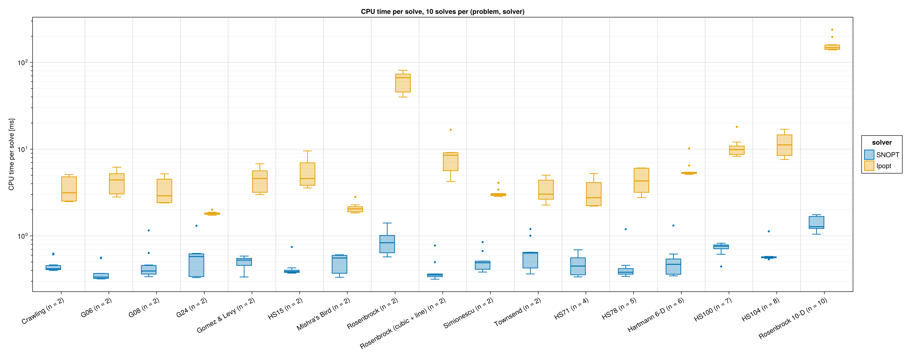

## `fitness` evaluation bar plot

`fitness` evaluation points in the record run, one category per problem, SNOPT
and Ipopt side by side. Unlike the iteration counts, this measure means the same
for both solvers. It is not the number of `fitness` calls, and SNOPT's counts
include one derivative-check point (see "Solver settings and comparability"). The
y axis is logarithmic, and each bar is labeled with its count. The counts are in
`results.csv`, and `julia bechmark/plot_evals.jl` redraws the plot without
re-running the benchmark.

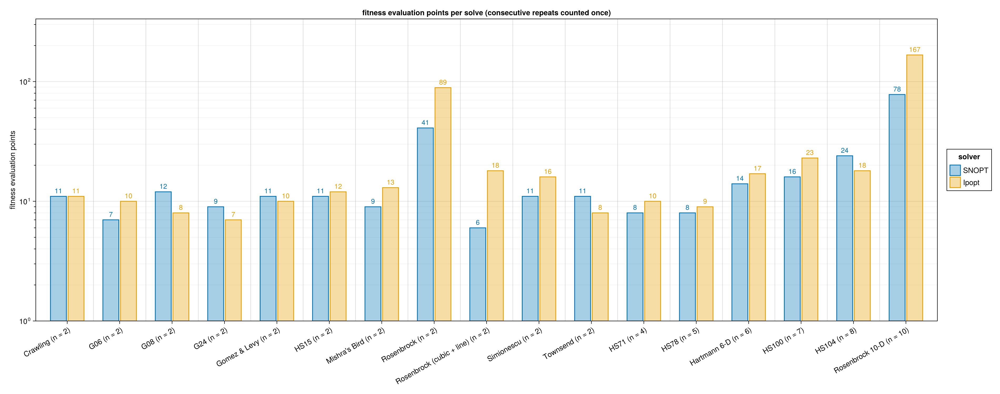

## Plots for 2-D benchmark problems

Contour plots are made only for the 2-D problems. In each figure SNOPT is on the
left and Ipopt on the right. The filled contours show the objective (log₁₀(f + ε)
for Rosenbrock, Rosenbrock (cubic + line), and HS15; f otherwise). Dashed white
curves are inequality constraints at zero (`cineq = 0`), and solid white curves are
equality constraints (`ceq = 0`). The colored path shows the `fitness`
evaluation points in order, with one color scale shared by both axes. The circle
marks `x0` and the star marks `xopt`. Axes keep the box's aspect ratio unless the
box is very tall or wide (G06), where the width is clamped for readability.

### Rosenbrock

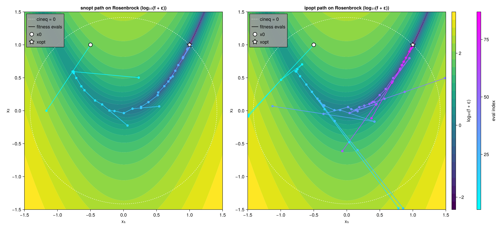

### Mishra's Bird

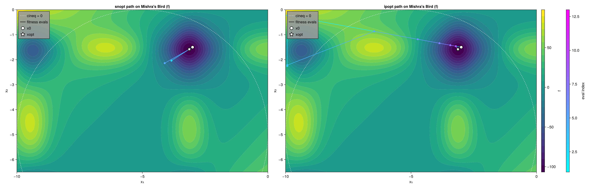

### Townsend

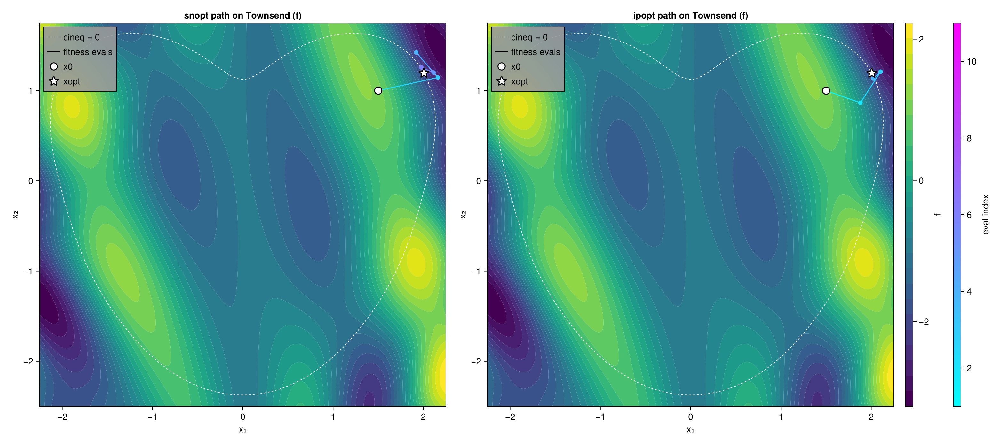

### Crawling

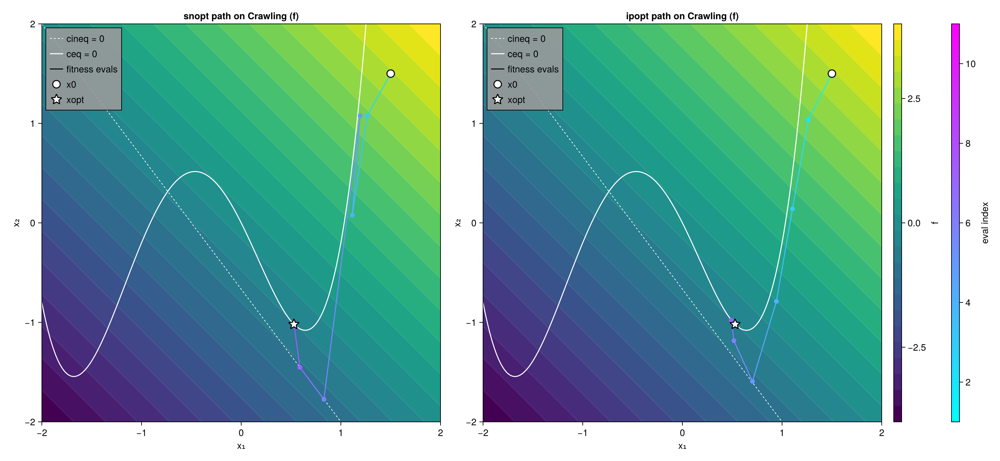

### Rosenbrock (cubic + line)

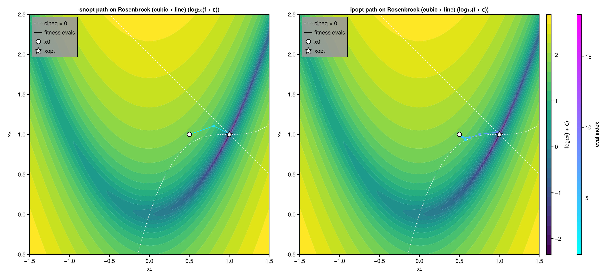

### Gomez & Levy

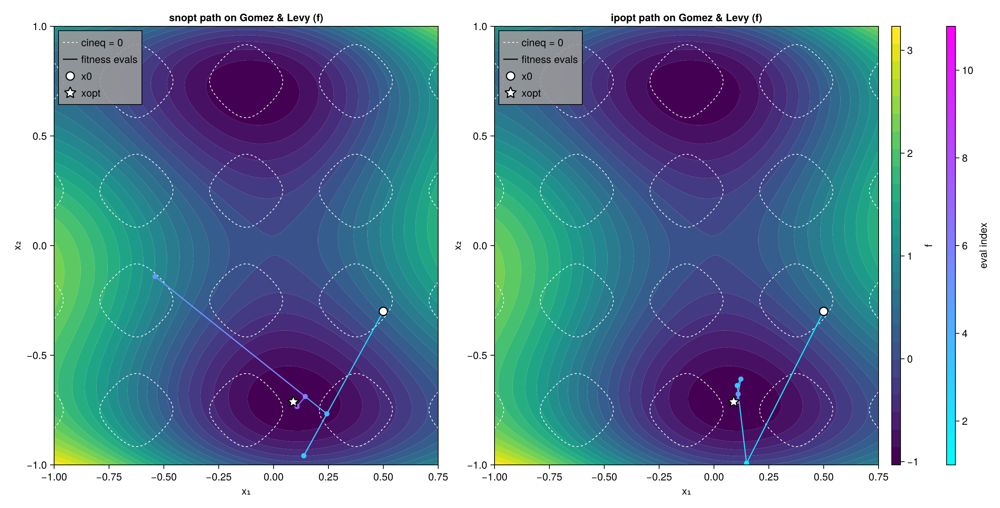

### Simionescu

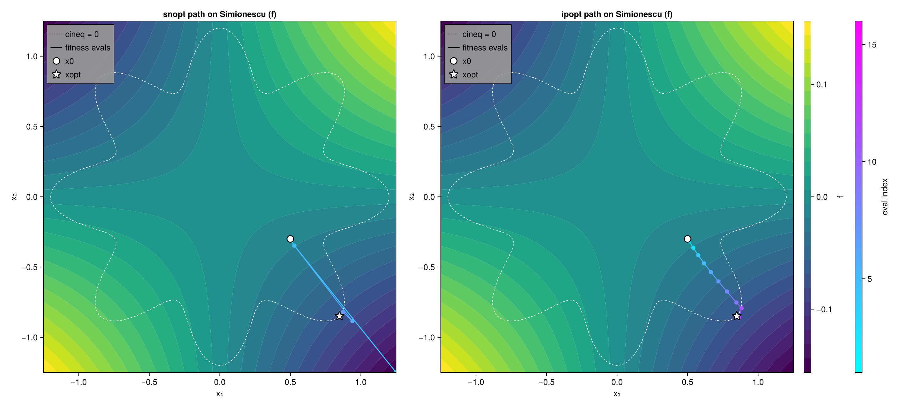

### HS15

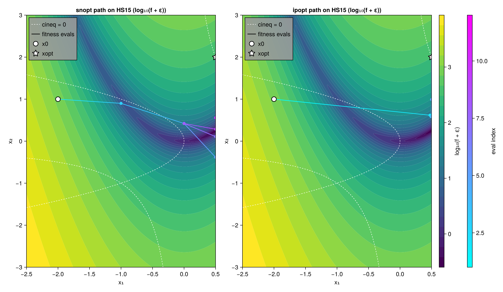

### G06

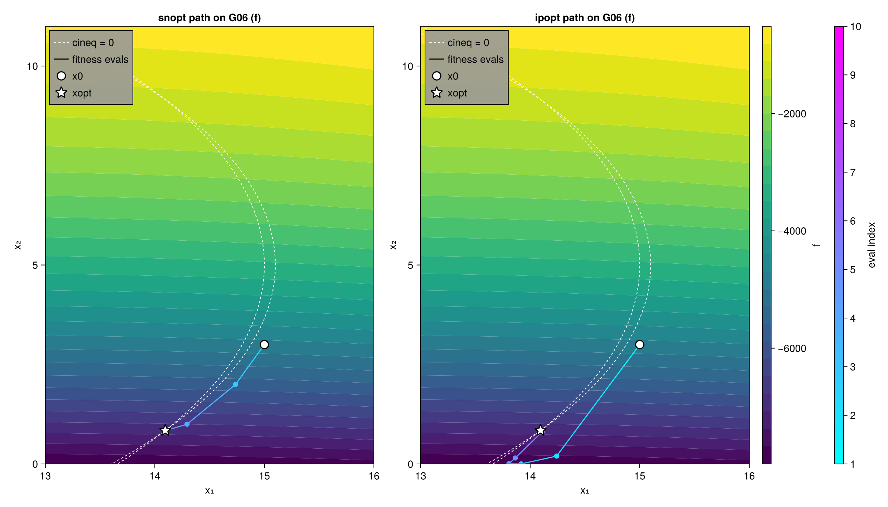

### G08

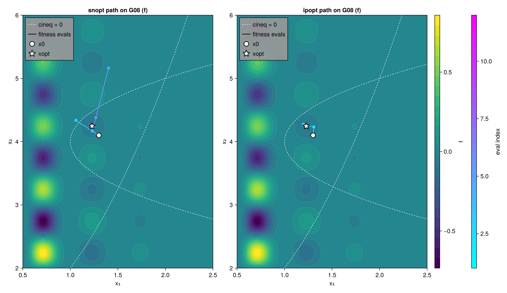

### G24

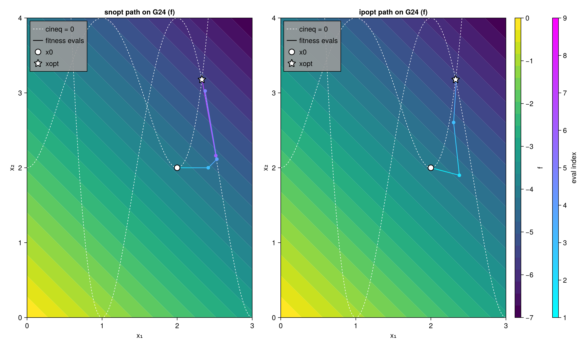
