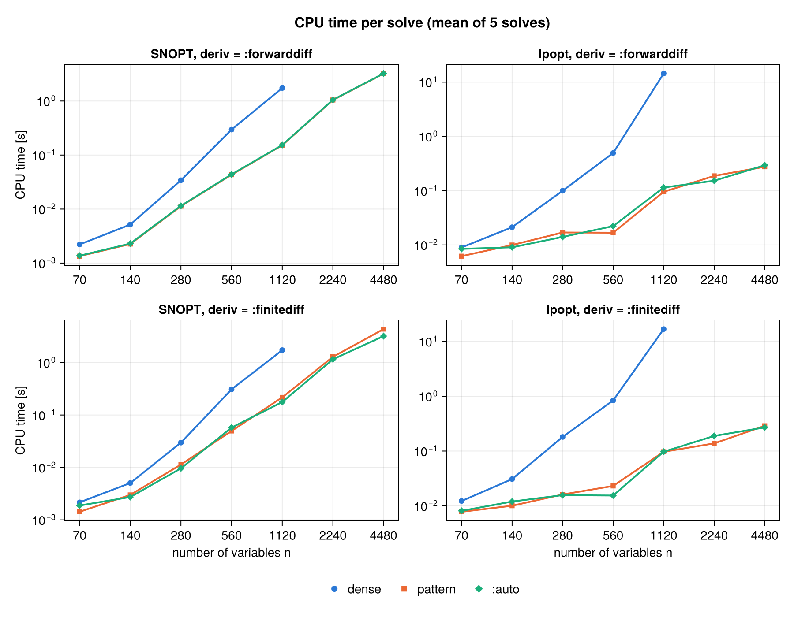
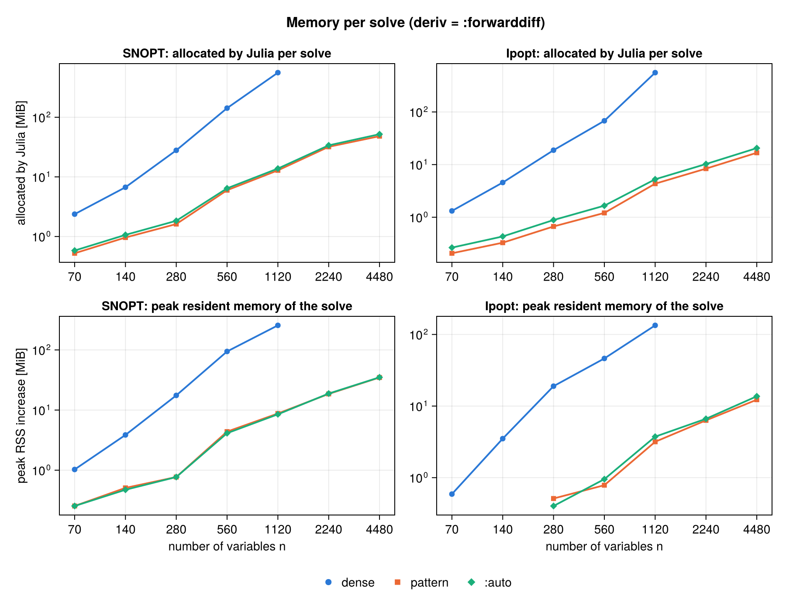

```@meta
CurrentModule = NLPInterface
```

# Sparse Jacobian

By default, [`solve_ipopt`](@ref) and [`solve_snopt`](@ref) compute and pass a
**dense** Jacobian of the stacked fitness output `[obj; ceq; cineq]`: all
`(1 + n_ceq + n_cineq) × n` entries, at every iterate. In many large problems
each constraint depends on only a few variables. Examples are collocation and
multiple-shooting transcriptions, chains, and networks. Then almost all of
those entries are zero.

The keyword `jac_sparsity` tells the solvers which entries can be nonzero.
With it:

- **Fewer `fitness` calls per Jacobian.** Columns that share no row are
  differentiated together (column coloring). A Jacobian costs about as many
  `fitness` calls as there are colors, not as there are variables.
- **Less memory.** Only the nonzero entries are stored and handed to the
  solver.
- **Faster solver linear algebra.** Ipopt factorizes a sparse KKT system,
  and SNOPT keeps a sparse basis. Both scale with the number of nonzeros, not
  with `(1 + m) · n`.

The default stays `jac_sparsity = nothing`, which is dense and unchanged.

## Quick start

The fastest way is automatic detection. Load
[SparseConnectivityTracer.jl](https://github.com/adrhill/SparseConnectivityTracer.jl)
and pass `jac_sparsity = :auto`:

```julia
using NLPInterface
using SparseConnectivityTracer   # enables jac_sparsity = :auto

n = 100
h = 0.1
function fitness(x)
    obj = (x[n] - 1)^2
    ceq = [x[i + 1] - x[i] - h * sin(x[i]) for i in 1:(n - 1)]
    return obj, ceq, nothing
end
x0 = zeros(n)
x_lb = fill(-10.0, n)
x_ub = fill(10.0, n)

xopt, fopt, info = solve_ipopt(fitness, x0, x_lb, x_ub, n - 1, 0; jac_sparsity=:auto)
xopt, fopt, info = solve_snopt(fitness, x0, x_lb, x_ub, n - 1, 0; jac_sparsity=:auto)
```

Here each equality constraint depends on two neighbouring variables, and the
objective depends on one. The Jacobian has `100 × 100` entries, of which 199 can
be nonzero. Two colors are enough, so a finite-difference Jacobian needs 3
`fitness` calls instead of 101, and a ForwardDiff Jacobian needs one Dual
evaluation instead of 9.

## What `jac_sparsity` accepts

| Value | Meaning |
|---|---|
| `nothing` (default) | Dense Jacobian. |
| a matrix of size `(1 + n_ceq + n_cineq, length(x0))` | The pattern. For a sparse matrix (also through `transpose`, `adjoint` or a view), every *stored* entry counts, including stored zeros. For any other matrix (`Matrix{Bool}`, `BitMatrix`, numbers), every nonzero entry counts. |
| `:auto` | Detect the pattern with [`detect_jac_sparsity`](@ref) at `x0`, using SparseConnectivityTracer's `TracerSparsityDetector()`. This needs `using SparseConnectivityTracer`. |
| an `ADTypes.AbstractSparsityDetector` | Detect the pattern with that detector, for example `TracerLocalSparsityDetector()`. |

Anything else throws an `ArgumentError` before `fitness` is called.

### Layout of the pattern

The rows of the pattern are the rows of the stacked output, in this order:

| Rows | Function |
|---|---|
| `1` | objective `obj` |
| `2 : 1 + n_ceq` | equality constraints `ceq` |
| `2 + n_ceq : 1 + n_ceq + n_cineq` | inequality constraints `cineq` |

Column `j` is the variable `x[j]`. Entry `(i, j)` must be in the pattern
whenever function `i` can depend on `x[j]` *anywhere* in the search
region, not just at `x0`.

### A pattern by hand

For the example above, build the pattern with `SparseArrays.sparse`:

```julia
using SparseArrays

n_ceq, n_cineq = n - 1, 0
rows = [1; 2:n; 2:n]            # objective row, then each ceq row twice
cols = [n; 1:(n - 1); 2:n]      # obj: x[n]; ceq[i]: x[i] and x[i + 1]
S = sparse(rows, cols, true, 1 + n_ceq + n_cineq, n)

xopt, fopt, info = solve_ipopt(fitness, x0, x_lb, x_ub, n_ceq, n_cineq; jac_sparsity=S)
```

A hand-made pattern costs nothing at solve time, and it works for any
`fitness`, including code that automatic detection cannot trace.

### Automatic detection

[`detect_jac_sparsity`](@ref) returns the pattern as a sparse Boolean matrix,
so you can inspect it and reuse it across many solves.
`jac_sparsity = :auto` detects it again in every solve, which costs one extra
`fitness` call with tracer numbers.

```julia
using SparseConnectivityTracer

S = detect_jac_sparsity(fitness, x0, n - 1, 0)    # 100×100 SparseMatrixCSC{Bool}
for x_start in starting_points
    solve_snopt(fitness, x_start, x_lb, x_ub, n - 1, 0; jac_sparsity=S)
end
```

The default detector, `TracerSparsityDetector()`, finds a **global** pattern
that holds at every `x`. It runs `fitness` on tracer numbers instead of
`Float64`. So `fitness` must be generic in the element type of `x`, which is
already required for `deriv = :forwarddiff`. A branch on the *value* of
`x`, such as `if x[1] > 0`, cannot be traced globally, and detection fails
with an `ArgumentError` that says so. You then have two options:

- Write the branch with `ifelse`, or give the pattern by hand.
- Pass `jac_sparsity = TracerLocalSparsityDetector()` (or
  `detect_jac_sparsity(...; detector = TracerLocalSparsityDetector())`). This
  gives the pattern **at `x0` only**. It is only safe when no entry that is
  zero at `x0` can become nonzero elsewhere.

Errors that `fitness` throws during detection, such as a `DimensionMismatch`
for a wrong constraint count or your own exceptions, are rethrown unchanged.

### Checking a pattern

Entries outside the pattern are taken to be zero and are never computed. A
pattern that **misses** a nonzero entry gives wrong derivatives, and the
solver will not tell you. A pattern with extra entries is safe, but slower.
To check a pattern, compare it with the dense Jacobian at a few random points:

```julia
using ForwardDiff
residual(x) = NLPInterface.packed_residual(fitness, x, n_ceq, n_cineq)
for _ in 1:5
    J = ForwardDiff.jacobian(residual, x_lb .+ rand(n) .* (x_ub .- x_lb))
    @assert all(iszero, J[.!Matrix(S)]) "pattern misses a nonzero entry"
end
```

## How many `fitness` calls a Jacobian costs

Two columns can share a color when no row has an entry in both. All columns
of one color are then perturbed at once, and each entry is read back from the
row it belongs to. NLPInterface colors the columns with
[SparseMatrixColorings.jl](https://github.com/gdalle/SparseMatrixColorings.jl)
(greedy, largest-first order). Variables that appear in no row get no color
and are never perturbed.

| `deriv` | dense | with `jac_sparsity` |
|---|---|---|
| `:finitediff` | `n` calls (+ 1 if the value at `x` is not known yet) | `ncolors` calls (+ 1) |
| `:forwarddiff` | `⌈n / chunk⌉` Dual calls | `⌈ncolors / 12⌉` Dual calls |

Here `chunk` is ForwardDiff's chunk size, at most 12. The finite-difference
steps are the same bound-aware one-sided steps as in the dense case. They are
taken per column, so `fitness` is still only evaluated inside `[x_lb, x_ub]`.

The number of colors is at least the largest number of entries in any row.
**A row that depends on every variable forces every column into its own
color.** That happens, for example, with an objective that sums over all
variables. Then a Jacobian costs as many calls as in the dense case. Memory
and the solver's linear algebra still benefit. To keep the number of colors
small in a transcription, write the objective in *Mayer form*: accumulate the
running cost in an extra state, and minimize that state's final value. The
benchmark problem below does this.

## Notes

- **Placeholder entries.** A constraint that does not depend on `x` has an
  empty row. Ipopt needs at least one Jacobian entry when there are
  constraints. SNOPT would treat a row without entries as linear, and would
  then ignore the value `fitness` returns for it. So the solvers add one
  placeholder entry, always zero, for such rows.
- **SNOPT sees a different problem structure.** Its nonlinear objective
  variables are those in row 1 of the pattern, and its nonlinear Jacobian
  variables are those in the constraint rows. With a sparse pattern SNOPT
  therefore takes different iterations than with a dense one. Both runs
  converge to the same point within the requested tolerances, but the
  iterates and iteration counts differ. Very tight tolerances (around
  `1e-10`) can end in `:Numerical_Difficulties` in one setting and not the
  other.
- **`:auto` and side effects.** With `:auto`, `fitness` is called once with
  tracer numbers before the solve starts, and before the solver checks its
  options. Keep logging and other side effects behind a check on
  `eltype(x) <: Float64` (see the [Tutorial](@ref)).
- **The pattern is fixed for the whole solve.**

## Benchmark: dense vs. sparse

`benchmark/sparse_jacobian.jl` compares the three modes, dense, a hand-made
`pattern`, and `:auto`, on a scalable problem. The problem is
`transcription_problem(N)` from `test/transcription.jl`: a minimum-energy
transfer of a planar double integrator around a circular obstacle,
transcribed by trapezoidal collocation on `N` nodes. Each node holds the state
`(px, py, vx, vy, e)` and the control `(ux, uy)`, where `e` accumulates the
energy and `e_N` is the objective (Mayer form). This gives:

- `n = 7N` variables;
- `5(N − 1) + 9` equality constraints (defects and boundary conditions);
- `N` inequality constraints (the obstacle);
- a Jacobian with `6N + 5` rows and `24N − 12` nonzero entries (dense:
  `(6N + 5) · 7N`, about `42N²`);
- 6 colors for every `N`.

**Protocol.** The protocol is the one of `benchmark/benchmark_problems.jl`.
For each solver, `deriv`, mode, and `N`, there is one untimed warm-up solve
(compilation), then `M = 5` timed solves. Each timed solve is preceded by
`GC.gc()` and timed with the process CPU clock. The same tolerances are used
as there: SNOPT `Major_feasibility_tolerance = Major_optimality_tolerance =
1e-6`, and Ipopt `tol = constr_viol_tol = dual_inf_tol = compl_inf_tol = 1e-6`.
Every other option is the solver's default. With `:auto`, detection is part of
every timed solve.

The dense runs stop at `n = 1120`. At that size a dense solve already takes
15–17 s with Ipopt, and the dense Jacobian has over a million entries.

Memory is measured in two ways:

- **Allocated** is the memory Julia allocates during one solve (`@timed`).
  This includes SNOPT's workspace, which NLPInterface allocates in Julia, but
  not Ipopt's own C++ memory.
- **Peak RSS** is measured by `benchmark/sparse_jacobian_rss.jl`, in a fresh
  process per configuration. It is the peak resident memory during the solve,
  minus the resident memory just before it. It covers everything, including
  the solvers' own memory.

All three modes reach the same objective at every size, within `2e-7`. For
Ipopt at `n ≥ 1120`, dense and sparse runs alike end with
`:Solved_To_Acceptable_Level`.

**Environment.** AMD Ryzen 9 7900X, Linux, Julia 1.12.1, Ipopt_jll 3.14.19,
SNOPT 7 (`libsnopt7.so`), ForwardDiff 1.4.7, SparseMatrixColorings 0.4.29,
SparseConnectivityTracer 1.2.4. Run on 2026-11-11.

### CPU time



**SNOPT**, CPU time per solve (mean of 5):

| n | `:forwarddiff` dense | pattern | `:auto` | speed-up | `:finitediff` dense | pattern | `:auto` | speed-up |
|---:|---:|---:|---:|---:|---:|---:|---:|---:|
| 70 | 2.21 ms | 1.34 ms | 1.37 ms | 1.6× | 2.16 ms | 1.43 ms | 1.88 ms | 1.5× |
| 140 | 5.17 ms | 2.26 ms | 2.3 ms | 2.3× | 5.05 ms | 2.99 ms | 2.73 ms | 1.7× |
| 280 | 34.2 ms | 11.3 ms | 11.5 ms | 3.0× | 29.7 ms | 11.3 ms | 9.61 ms | 2.6× |
| 560 | 296 ms | 43.2 ms | 43.9 ms | 6.8× | 309 ms | 49.6 ms | 57.7 ms | 6.2× |
| 1120 | 1.74 s | 152 ms | 153 ms | 11× | 1.73 s | 217 ms | 177 ms | 8.0× |
| 2240 | — | 1.04 s | 1.05 s | — | — | 1.29 s | 1.15 s | — |
| 4480 | — | 3.22 s | 3.24 s | — | — | 4.35 s | 3.2 s | — |

**Ipopt**, CPU time per solve (mean of 5):

| n | `:forwarddiff` dense | pattern | `:auto` | speed-up | `:finitediff` dense | pattern | `:auto` | speed-up |
|---:|---:|---:|---:|---:|---:|---:|---:|---:|
| 70 | 8.99 ms | 6.21 ms | 8.47 ms | 1.4× | 12.3 ms | 7.8 ms | 8.12 ms | 1.6× |
| 140 | 21.2 ms | 9.97 ms | 9.05 ms | 2.1× | 30.8 ms | 10.1 ms | 12 ms | 3.1× |
| 280 | 99.6 ms | 17 ms | 14.1 ms | 5.9× | 181 ms | 16.1 ms | 15.7 ms | 11× |
| 560 | 494 ms | 16.8 ms | 22.2 ms | 29× | 837 ms | 23.1 ms | 15.4 ms | 36× |
| 1120 | 14.4 s | 95.2 ms | 114 ms | 151× | 16.8 s | 96.9 ms | 97.2 ms | 173× |
| 2240 | — | 187 ms | 153 ms | — | — | 138 ms | 189 ms | — |
| 4480 | — | 276 ms | 294 ms | — | — | 288 ms | 270 ms | — |

The speed-up is the dense time divided by the `pattern` time.

- **Ipopt.** The speed-up grows from about 1.5× at `n = 70` to over 150× at
  `n = 1120`. With a dense Jacobian, every KKT system Ipopt factorizes
  contains a dense `(6N + 5) × 7N` block. Its time per solve grows by 2–6×
  each time `n` doubles up to `n = 560`, then by 20–29× to `n = 1120`. With the pattern, it grows almost linearly:
  0.28 s at `n = 4480`.
- **SNOPT.** The speed-up reaches 8–11× at `n = 1120`. With the pattern,
  SNOPT needs only 12–24 `fitness` calls with ForwardDiff at every size (see
  below). Its remaining time grows faster than linearly because of its own
  linear algebra, not because of derivatives.
- **`:auto` vs. `pattern`.** Apart from detection, which adds one `fitness`
  call with tracer numbers per solve, the two do the same work. Their times
  agree within the spread between the 5 timed solves. That spread is up to
  ±30% for Ipopt here, and 3.7–4.7 s for SNOPT `:finitediff` with `pattern`
  at `n = 4480`. The min–max range of every configuration is in
  `benchmark/sparse_results.csv`.

### `fitness` calls

`fitness` calls per solve (`:auto` adds one call with tracer numbers):

| n | SNOPT `:forwarddiff` dense / sparse | SNOPT `:finitediff` dense / sparse | Ipopt `:forwarddiff` dense / sparse | Ipopt `:finitediff` dense / sparse |
|---:|---:|---:|---:|---:|
| 70 | 80 / 13 | 924 / 78 | 105 / 30 | 1066 / 106 |
| 140 | 110 / 12 | 1270 / 71 | 182 / 28 | 1975 / 99 |
| 280 | 290 / 17 | 3373 / 106 | 375 / 30 | 4216 / 106 |
| 560 | 942 / 22 | 32539 / 148 | 672 / 28 | 7855 / 99 |
| 1120 | 1882 / 21 | 22421 / 134 | 2850 / 60 | 33631 / 211 |
| 2240 | — / 24 | — / 155 | — / 58 | — / 204 |
| 4480 | — / 23 | — / 148 | — / 58 | — / 204 |

A sparse Jacobian costs 6 colors: one Dual evaluation with ForwardDiff, or 7
calls with finite differences. A dense one costs `⌈n / 12⌉` Dual evaluations,
or `n + 1` calls. The total also includes the solver's line-search
evaluations. This is why the counts do not drop by exactly the same factor.

### Memory



Memory per solve with `deriv = :forwarddiff` (`:finitediff` gives similar numbers). *Allocated* is the memory Julia allocates during the solve. *Peak RSS* is the peak resident memory of the solve, above the resident memory before it, including what Ipopt and SNOPT allocate themselves:

| n | Jacobian entries dense / pattern | SNOPT allocated dense / pattern | SNOPT peak RSS dense / pattern | Ipopt allocated dense / pattern | Ipopt peak RSS dense / pattern |
|---:|---:|---:|---:|---:|---:|
| 70 | 4,550 / 228 | 2.37 MiB / 536 KiB | 1.03 MiB / 260 KiB | 1.32 MiB / 212 KiB | 604 KiB / < 0.1 MiB |
| 140 | 17,500 / 468 | 6.7 MiB / 984 KiB | 3.86 MiB / 520 KiB | 4.57 MiB / 337 KiB | 3.51 MiB / < 0.1 MiB |
| 280 | 68,600 / 948 | 27.9 MiB / 1.62 MiB | 17.5 MiB / 788 KiB | 18.8 MiB / 685 KiB | 19 MiB / 524 KiB |
| 560 | 271,600 / 1,908 | 142 MiB / 5.98 MiB | 94.4 MiB / 4.38 MiB | 67.9 MiB / 1.21 MiB | 46.2 MiB / 804 KiB |
| 1120 | 1,080,800 / 3,828 | 560 MiB / 12.9 MiB | 256 MiB / 8.76 MiB | 558 MiB / 4.34 MiB | 134 MiB / 3.17 MiB |
| 2240 | 4,312,000 / 7,668 | — / 31.9 MiB | — / 18.6 MiB | — / 8.38 MiB | — / 6.32 MiB |
| 4480 | 17,225,600 / 15,348 | — / 48.2 MiB | — / 34.8 MiB | — / 16.8 MiB | — / 12.3 MiB |

Points below 0.1 MiB are not drawn in the figure.

The dense Jacobian grows with `n²`: it has 1.08 million entries at
`n = 1120` and would have 17 million at `n = 4480`. The pattern grows with
`n`: 3,828 and 15,348 entries. At `n = 1120`, a sparse solve allocates about
40× (SNOPT) and 130× (Ipopt) less memory in Julia than a dense one, and its
peak resident memory is about 30× (SNOPT) and 40× (Ipopt) lower.

### Small dense problems

`jac_sparsity` does not pay off when the Jacobian is small or mostly dense.
`benchmark/benchmark_problems.jl auto` solves the 17 test problems of
`test/problems.jl`, which have 2 to 10 variables, with `jac_sparsity = :auto`.
Compared with the default dense run, its median CPU time per solve is about
18% higher for SNOPT and 9% higher for Ipopt, with the same number of
`fitness` calls in all but one case. That cost is the pattern detection and
coloring in every solve. To track this, the CSV files of both runs are kept in
`benchmark/results_log/` (`results_<commit>.csv` and
`results_<commit>_auto.csv`). Use `jac_sparsity` when the problem has more
than a few dozen variables and each constraint depends on few of them.

